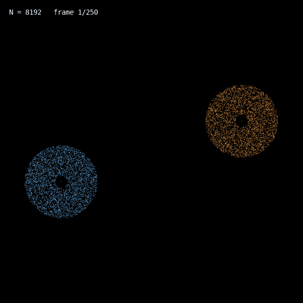
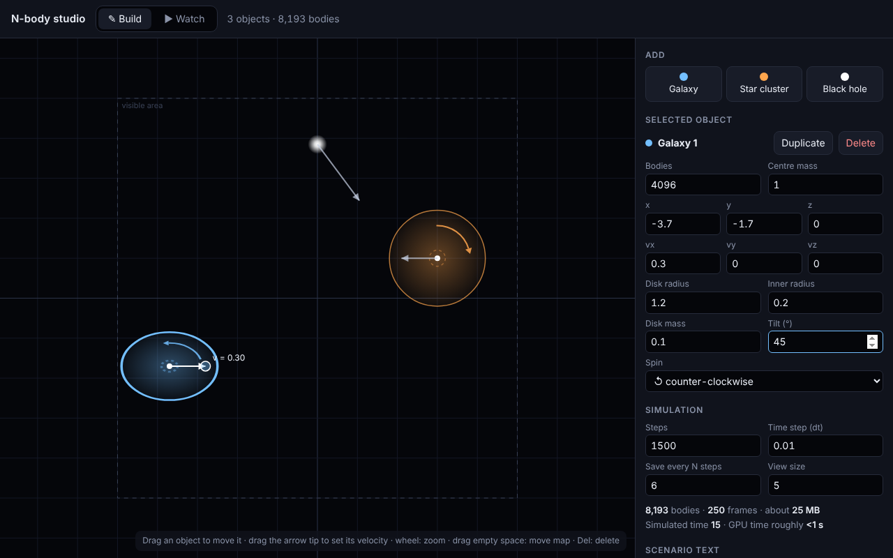
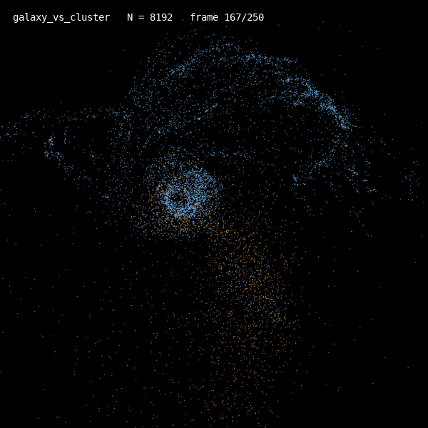
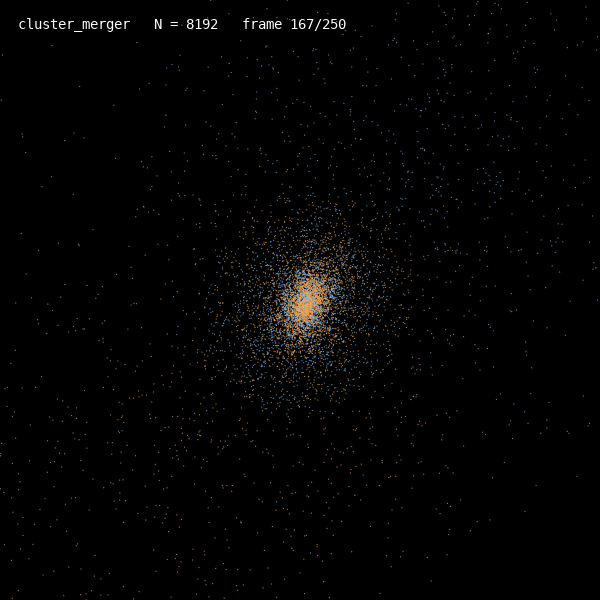
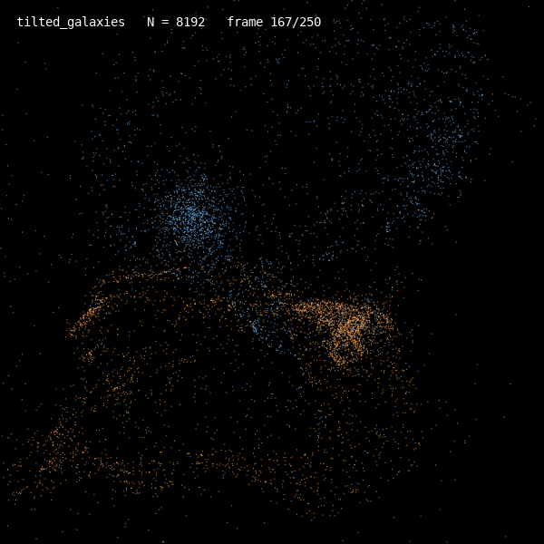
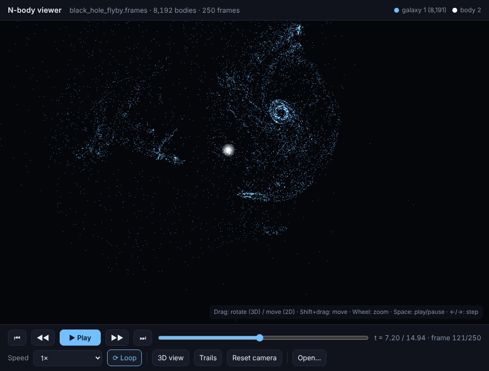

# CUDA N-Body: Galaxy Collision

A gravitational N-body simulation written in CUDA C++. Every body attracts every
other body, so one simulation step costs **N² interactions**. That is a workload a GPU
handles very well, and this project measures how well.

### ▶ [Try it in your browser](https://sotirismavrommatis.github.io/cuda-nbody/)

There is nothing to install. Place galaxies and black holes with the mouse, press **Run**, and
the simulation runs on *your* graphics card through WebGPU. It works with any recent GPU
(NVIDIA, AMD, Intel or Apple) in a recent Chrome or Edge.



*Two rotating disk galaxies (8,192 bodies) pass through each other. Tidal forces pull out
streams of stars. The full 1,500-step simulation runs in about 0.3 s on a laptop GPU.*

## What's inside

| Version | Idea |
|---|---|
| **CPU** | Plain double loop, single thread. Used as the reference result. |
| **GPU naive** | One thread per body. Each thread reads all N bodies from global memory. |
| **GPU tiled** | Each block loads 256 bodies at a time into **shared memory**, and all 256 threads reuse that tile. Global memory traffic drops by about 256×. |

The program checks itself before it benchmarks anything. It runs the same simulation on
the CPU and on both GPU kernels and compares the positions. Both kernels match the CPU
to within `2.4e-07`.

## The studio: design a collision and watch it

Double-click **`start_studio.bat`**. It opens a small app in your browser with two tabs:

- **Build**: place galaxies, star clusters and black holes on a map with the mouse. Drag an
  object to move it, and drag the tip of its arrow to set its velocity. A side panel lets you
  edit everything else (number of stars, mass, size, spin, tilt), along with the simulation
  length. Every change also appears as scenario text, and editing the text updates the map.
- **Run** simulates the scene on the GPU, and the result opens straight away in the
  **Watch** tab, the interactive player described below.

There are two engines that run the same physics. The scene setup is the same in both,
but each engine uses its own random numbers to place the stars:

| Engine | Where | Needs |
|---|---|---|
| **WebGPU** | In the browser, ported to a WGSL compute shader with the same tiled algorithm | Any recent GPU and browser. It also works in the [online version](https://sotirismavrommatis.github.io/cuda-nbody/). |
| **CUDA** | `nbody.exe`, run for the browser by `server.py` | An NVIDIA GPU and the CUDA Toolkit. Start it with `start_studio.bat`. |

The WebGPU kernel was checked against a double-precision CPU reference. After 60 steps
the positions agree to within 4·10⁻⁶. On the test laptop, the galaxy collision (8,192
bodies, 1,500 steps) takes **0.33 s with CUDA on the RTX 5070** and 12 s with WebGPU, because
the browser picked the laptop's integrated AMD graphics. Laptops with two GPUs often do
this. You can fix it in Windows under *Settings → System → Display → Graphics*.



Behind the scenes, `server.py` (Python standard library only) runs `nbody.exe` for the
browser. It only listens on `127.0.0.1`, so it can't be reached from other computers. It
refuses runs that are too large (more than 131,072 bodies, or a result over 1.5 GB).

## Make your own collisions (text files)

What collides with what is not hard-coded. Each simulation is described by a small text
file in [`scenarios/`](scenarios/). You can mix **galaxies**, **star clusters** and single
**heavy bodies** (such as black holes), and set their positions, velocities, masses, spin
and tilt:

```text
steps = 1500
view = 5

galaxy   count=6144  x=-2.5 y=-0.8  vx=0.25  spin=1
cluster  count=2048  x=3    y=1     vx=-0.45 mass=0.6 radius=0.25
```

On Windows, **drag a scenario file onto `simulate.bat`**. It runs the simulation, writes
`output/<name>.frames` for the viewer and `output/<name>.gif`, and opens the viewer for you.
The full list of settings is in [`scenarios/README.md`](scenarios/README.md).

| Galaxy vs. star cluster | Two clusters merging | Tilted galaxies (3D) |
|:---:|:---:|:---:|
|  |  |  |
| `galaxy_vs_cluster.txt` | `cluster_merger.txt` | `tilted_galaxies.txt` |

There is also `black_hole_flyby.txt`, in which a black hole twice as heavy as the galaxy's
centre flies past and tears out long tidal arms.

## Watch it interactively

The **Watch** tab plays a simulation. It opens automatically after **Run** in the studio. You can
also open `viewer.html` directly in any browser, with no installation and no internet needed,
and drop in a `.frames` file from the `output` folder. You get:

- **Play / pause, rewind, step frame by frame**, and a timeline slider to jump to any moment
- **Playback speed** from 0.1× slow motion to 4×, including reverse
- **3D view**: drag to rotate the camera, so tilted galaxies can be seen from the side
- **Zoom and pan** with the mouse wheel and drag, plus optional **trails** behind moving bodies
- Keyboard shortcuts: `Space` play/pause, `←`/`→` step, `Home`/`End`, `+`/`−` speed



## Results

NVIDIA GeForce RTX 5070 Laptop GPU (36 SMs), CUDA 13.5, Windows 11. Times are per
simulation step.

| N | CPU (1 thread) | GPU naive | GPU tiled | Tiled GFLOPS* | Tiled vs CPU |
|---:|---:|---:|---:|---:|---:|
| 1,024 | 2.88 ms | 0.058 ms | 0.029 ms | 728 | 100× |
| 4,096 | 47.2 ms | 0.224 ms | 0.091 ms | 3,694 | 520× |
| 16,384 | 695 ms | 0.911 ms | 0.602 ms | 8,917 | 1,154× |
| 65,536 | *(too slow)* | 13.3 ms | 10.6 ms | 8,087 | – |

\* Counted as 20 FLOPs per interaction, the usual convention for N-body benchmarks.

**What the numbers show**
- **GPU speedup grows with N.** At small N the GPU is underused: 1,024 threads is far fewer
  than the GPU can run at once. From N ≈ 16K the GPU is saturated at roughly 8–9 TFLOPS.
- **Shared memory helps most at mid-size N** (2.5× at N = 4096). At larger N the GPU's
  L1/L2 caches already absorb much of the reuse in the naive version, so the gap shrinks
  to about 1.25×.
- The CPU baseline is a single unoptimised thread. A multithreaded, SIMD CPU version would
  narrow the gap considerably, but it would still be much slower than the GPU.

## Physics

- Units with `G = 1`. Softening `ε² = 0.0025` keeps forces finite when two bodies get very
  close.
- Semi-implicit (symplectic) Euler integration. The default is `dt = 0.01`, and each
  scenario can set its own.
- **Galaxy:** one heavy central mass plus a thin disk of stars on circular orbits.
- **Star cluster:** a [Plummer sphere](https://en.wikipedia.org/wiki/Plummer_model) whose
  velocities are sampled so that it starts in equilibrium (virial ratio 2K/|W| ≈ 1).

## Build and run

Requirements: an NVIDIA GPU, the [CUDA Toolkit](https://developer.nvidia.com/cuda-downloads),
and, on Windows, Visual Studio with the *Desktop development with C++* workload.
Rendering the GIF needs Python with `numpy`, `matplotlib` and `pillow`.

**Windows (easy way):**
- `start_studio.bat`: the studio. Build scenarios with the mouse, run them and watch them in the browser.
- `simulate.bat`: drag a scenario `.txt` onto it, or double-click it to run `scenarios/galaxies.txt`
- `run_all.bat`: runs every scenario and makes a GIF for each
- `benchmark.bat`: CPU vs GPU verification plus the benchmark table above

Everything is written to the `output/` folder: a `.frames` file for `viewer.html`, a GIF,
a still PNG and a log file for each run.

**By hand:**
```bash
nvcc -O3 -o nbody nbody.cu
./nbody bench                                     # verify + benchmark
./nbody scenarios/galaxies.txt galaxies.frames      # run a scenario
python render.py galaxies.frames galaxies.gif galaxies  # make a GIF (optional)
# ...or open viewer.html in a browser and drop galaxies.frames into it
```

## Files

| File | Purpose |
|---|---|
| `nbody.cu` | Simulation, CUDA kernels, scenario loader, verification and benchmark |
| `viewer.html` | The studio: scenario builder (Build tab), WebGPU engine and interactive player (Watch tab). This is also the online version. |
| `server.py` | Local server that lets the studio run `nbody.exe`. Used by `start_studio.bat`. |
| `render.py` | Turns a `.frames` file into a GIF and a still `.png`, one colour per object |
| `scenarios/` | Example scenarios and the format guide |
| `start_studio.bat`, `simulate.bat`, `run_all.bat`, `benchmark.bat` | One-click scripts for Windows (`_build.bat` is a shared helper) |

## Ideas for next steps

- Real-time OpenGL rendering through CUDA–OpenGL interop, instead of writing frames to disk
- Leapfrog or Runge-Kutta integration, plus an energy-conservation check
- Barnes–Hut tree, O(N log N), for millions of bodies
- Multithreaded CPU baseline (OpenMP) for a fairer comparison
